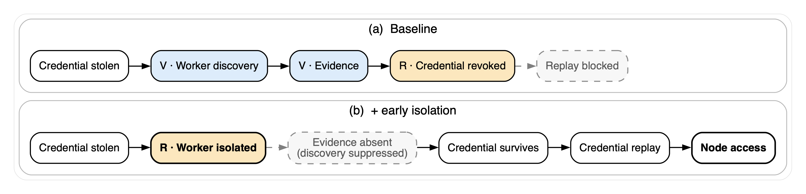

# Muster

**Muster replays a known security incident under different defenses and reports
what the attacker can still do afterward.**

After an incident it is easy to point at a control and say "this would have
stopped the attack." Stopped what, though? Initial access? Node root? One
branch, or every branch? Muster turns that sentence into something you can run:
hold a compressed incident trace fixed, add or move a defense, replay, and read
off which attacker capabilities are still reachable.

It is a small Go engine with YAML scenarios and a Jupyter notebook on top. It
was built in September 2026 for the Apart Research Incident Response Sprint,
and the research is written up in
[**Watchlines and Muster: Executable Counterfactuals for Cyber Defense**](writeup/muster-writeup.pdf).

## What it looks like

Here is Muster's model of the July 2026 Hugging Face intrusion, replayed under
five defensive configurations. Each cell answers one question: at the end of
the replay, does the attacker have this capability?

| Defense                                | Node root | Internal network | Cluster admin | Worker secrets exposed |
| -------------------------------------- | :-------: | :--------------: | :-----------: | :--------------------: |
| Observed signal, no page (as reported) |    yes    |       yes        |      yes      |          yes           |
| Privileged/hostPath admission policy   |    no     |        no        |      no       |          yes           |
| Cluster-scoped connector identity      |    yes    |       yes        |      no       |          yes           |
| Critical page + worker isolation       |    no     |        no        |      no       |          yes           |
| Dataset local-file-read hardening      |    yes    |       yes        |      yes      |           no           |

```bash
go run . experiment --file experiments/hf-july-2026.yaml
```

Every one of these controls works at the thing it was designed to do. None of
them leaves the attacker with nothing. The first row abstracts what Hugging Face
reported; the other four are counterfactuals over a compressed model, not claims
about what would certainly have happened in the real incident.

## What the research found

The sprint asked three questions. The answers are below, with the command that
reproduces each one. The [writeup](writeup/muster-writeup.pdf) has the full
argument in ten pages.

### 1. Different controls leave different problems behind

In the Hugging Face model above, an admission policy that rejects privileged
pods cuts off node root and everything downstream of it, but does nothing about
the credentials exposed earlier through the dataset file-read path. Hardening
that file read does the opposite: it protects the credentials and leaves the
rest of the intrusion intact. Scoping the connector identity is narrower still.

So "did the control work?" is the wrong question. The useful one is: **what is
still true afterward?**

### 2. Replay only earns its keep when the defender's memory matters

A fair objection is that a dependency graph already tells you all of this. We
tested that before trusting the tool, with the incident, controls, predictions,
and stop conditions frozen ahead of the decisive runs.

Mostly the objection held. Several experiments collapsed to the obvious static
answer: block a required edge and the downstream path disappears. Those are
recorded as collapses, not dressed up as results.

One did not collapse. Two scenarios differ only in when the attacker impairs
worker telemetry: before stealing a credential, or just after. Under the same
defenses, both runs arrive at the same attacker position and then diverge. The
only difference left is that in one of them the defender had already recorded
an alert before telemetry went dark. That remembered alert later enables review
and credential revocation. Without it, the attacker reaches the node. Swap in a
reviewer that only sees current state and the difference disappears.

```bash
go run . replay --scenario examples/gate2-early.yaml   --controls examples/gate2-broad-correlated.yaml
go run . replay --scenario examples/gate2-between.yaml --controls examples/gate2-broad-correlated.yaml
```

Replay is not useful just because an incident has an order. It is useful when
what the defender saw earlier changes what the defender can do later.

### 3. A working control can make the outcome worse

This one is a synthetic fixture, built on purpose, and it is the strangest
result in the repository.



In the baseline, the attacker steals a cluster credential, then does Kubernetes
discovery from the compromised worker. That discovery is the evidence that
triggers revocation of the stolen credential, and the attack is contained.

Now add early worker isolation. It works: worker access is cut off. But the
later discovery never happens, so the evidence is never produced, so the
credential is never revoked. A stolen credential does not need the worker it
was stolen from, so the attacker replays it and reaches the node. Adding a
functioning control ended with *more* attacker capability.

```bash
go run . experiment --file experiments/toy-jackpot.yaml
```

To check that the mechanism is what we said it was, four perturbations were
preregistered (in commit `dad8bf9`, before the fixtures or runs existed):

| Perturbation                           | Predicted reversal | Observed |
| -------------------------------------- | :----------------: | :------: |
| Baseline                               |        yes         |   yes    |
| Add an unrelated side branch           |        yes         |   yes    |
| Add an independent evidence path       |         no         |    no    |
| Isolate only after the evidence exists |         no         |    no    |

```bash
go run . experiment --file experiments/toy-jackpot-sensitivity.yaml
```

This is an existence proof, not a frequency claim. It does not show that such
reversals are common, and it says nothing about the Hugging Face incident. The
lesson it supports is narrower: good controls do not automatically add up to a
good defense, because containment is not always causally independent of
investigation.

## How Muster works

The model is deliberately small.

- **State** is a set of facts, such as `attacker:worker-access` or
  `alert:worker-compromise`.
- **Events** are the steps of the incident, in the order the scenario supplies.
  Each has preconditions and effects. If an event's preconditions are not met,
  it is skipped and replay moves on.
- **Controls** are attached to events. They can observe (record an alert),
  block (stop the event), or respond (change state afterward, for example by
  removing a stolen credential). Review, criticality, and escalation steps sit
  between observing and responding, so a response path can fail in the middle.
- **Replay** is one deterministic pass. The output is the terminal state, plus
  a trace of what every control did at every step.

An event and a control look like this:

```yaml
# scenario: one step of the incident
- id: privileged-hostpath-pod
  requires:
    present: [attacker:worker-access, attacker:cluster-knowledge]
  effects:
    add: [attacker:privileged-hostpath]

# control: a defense attached to that step
- id: reject-privileged-hostpath
  role: picket
  events: [privileged-hostpath-pod]
  substrate: kubernetes-admission
  action: block
```

Scenarios and controls live in YAML. Replay semantics live in Go and nowhere
else; the notebooks only select controls and display what the engine returns.

### Watchlines

Muster needed a way to talk about what a defense is *doing* at a given point in
an incident, as opposed to which product or layer it belongs to. That
vocabulary is the Watchline, which groups defenses by causal role:

| Role        | Job                                             | In the model                         |
| ----------- | ----------------------------------------------- | ------------------------------------ |
| **Vedette** | See: something is happening.                    | Adds to what the defender knows.     |
| **Picket**  | Interrupt: not through here.                    | Blocks an attacker step.             |
| **Reserve** | Contain: we were wrong, so limit the damage.    | Changes state after a compromise.    |

These map roughly onto Detect / Protect / Respond, with one difference that
matters: they are not stages in a pipeline. All three can recur several times
in one incident, and results 2 and 3 above are both about what happens when the
connections between them break.

## Try it

### Command line

You need [Go](https://go.dev/dl/) 1.22 or newer. Nothing else.

```bash
git clone https://github.com/bubskee/muster
cd muster
go run . experiment --file experiments/hf-july-2026.yaml
```

Experiments print a Markdown table by default; add `--format json` or
`--format csv` for machine-readable output. To replay a single scenario against
a single set of controls and see the terminal state:

```bash
go run . replay \
  --scenario examples/hf-july-2026/scenario.yaml \
  --controls examples/hf-july-2026/admission-policy.yaml
```

Add `--json` for the full step-by-step trace. `go test ./...` runs the engine
tests.

### Notebook

[`notebooks/muster_lab.ipynb`](notebooks/muster_lab.ipynb) is the friendliest
way in. You pick defenses under a small budget, replay a toy incident, and see
what the attacker can still reach. The preset called "Want something
counterintuitive?" walks you into result 3. No Go or Python knowledge is needed
to use it, but both have to be installed, along with Jupyter:

```bash
python3 -m pip install jupyter ipywidgets
python3 -m jupyter notebook notebooks/muster_lab.ipynb
```

Then choose **Run All**. Once the toy incident feels intuitive, switch the
scenario dropdown to the Hugging Face model.

<details>
<summary>Installing Go and Python</summary>

**macOS**, with [Homebrew](https://brew.sh/):

```bash
brew install go python
```

**Windows**, with `winget`:

```powershell
winget install GoLang.Go
winget install Python.Python.3
```

**Ubuntu / Debian:**

```bash
sudo apt update
sudo apt install golang-go python3 python3-pip
```

Check with `go version` and `python3 --version`. On Windows, use `python` if
`python3` is unavailable.

</details>

## Incident models

| Model | What it is | Run it |
| --- | --- | --- |
| [Hugging Face, July 2026](examples/hf-july-2026/) | Ten-event abstraction of the intrusion, built from Hugging Face's published technical timeline. | `experiments/hf-july-2026.yaml` |
| [Anthropic / PyPI, 2026](examples/anthropic-pypi-2026/) | An evaluation-environment incident that crossed three owners: the eval operator, a public package registry, and a third-party security vendor. Asks which owner could have interrupted it, and where. | `experiments/anthropic-pypi-2026.yaml` |
| [Toy incident](examples/notebook/) | Six-event synthetic incident used by the notebook and by result 3. | `experiments/toy-jackpot.yaml` |

The two real-incident models are compressed from public reporting. They are
not forensic reconstructions, and each example folder lists its sources and
what it leaves out.

## What Muster cannot tell you

- **The analyst supplies the model.** Events, their order, their dependencies,
  and what each control does are all chosen by whoever writes the scenario. A
  missing path or a wrong dependency changes the answer. Running the model
  makes those assumptions inspectable; it does not make them correct.
- **The attacker does not adapt.** Replay is a single pass over a fixed trace.
  A blocked step stays blocked unless another route was already written in.
- **No probability, time, or cost.** Muster knows event order and nothing about
  how long things take, how often a control fires, false positives, or what a
  defense costs to deploy and operate.
- **Hindsight is built in.** A Picket matched to a known trace has an advantage
  no defender has in advance.

> You can test whether your Watchline survives the attacks you imagined. You
> cannot replay the attack you failed to imagine.

Muster is a counterfactual reasoning aid. It is not a cyber range, an attacker
emulator, or a threat model. It does not scan systems, find vulnerabilities, or
search for bypasses, and its incident fixtures contain nothing beyond public
reporting. The writeup discusses dual-use considerations in more detail.

## Still open

Muster's representation is conventional, and the contribution was never meant
to be a new formalism. After the sprint, the obvious question was how much of
it is just a convenient presentation of ideas that existing formalisms already
have. Two append-only research notebooks follow that question:

- [`the-road-goes-ever-on/grap-theory.md`](the-road-goes-ever-on/grap-theory.md)
  maps Muster onto Petri nets. [`petri-watchline/`](petri-watchline/) compiles
  the toy incident into a colored Petri net and reproduces both the reversal in
  result 3 and the defender-history effect in result 2. So far: neither needs
  machinery Muster invented. Defender history is ordinary state dependence.
- [`the-road-goes-ever-on/hostile-graphs.md`](the-road-goes-ever-on/hostile-graphs.md)
  moves to attack graphs and related security formalisms, and asks whether
  fixed-trace replay with explicit defender state exposes anything those do
  not already make convenient. That one is unresolved.

The next experiment is to stop handing Muster a single fixed trace. Give it a
handful of nearby ones, change a branch, move an event, break a dependency, and
see when the answer changes. That is still not foresight, but it gets closer to
the question Watchlines were meant to ask: how wrong can we be and still be
okay?

## Repository map

| Path | Contents |
| --- | --- |
| `main.go`, `engine/`, `state/`, `config/`, `experiment/` | The replay engine, YAML loading, and the experiment runner. |
| `examples/` | Incident models and control sets, each with provenance notes. |
| `experiments/` | Experiment definitions: which scenario, which controls, which facts to report. |
| `notebooks/` | `muster_lab` (interactive) and `muster_trace` (trace comparison). |
| `writeup/` | The sprint paper, plus drafts. |
| `figures/` | Figure 1 from the paper and the script that draws it. |
| `runs/` | Recorded outputs: the sensitivity results and the traces `muster_trace` reads. |
| `petri-watchline/`, `the-road-goes-ever-on/` | Post-sprint formalism comparisons. |
| `scenarios/`, `watchlines/` | Earlier Go-defined fixtures and their tests, from before scenarios moved to YAML. |
| `dev/archive/` | The working record: frozen experiment designs, preregistrations, and the red-team reviews the project was put through along the way. |

## Credits

Muster was written by Bobby Faber for the Apart Research Incident Response
Sprint. Joshua Ballard-Myer contributed review, additional experimental
support, and conceptual development. LLMs were used heavily for implementation
and for attacking the work; the writeup has a full usage statement.

The incident models rest on public reporting by
[Hugging Face](https://huggingface.co/blog/agent-intrusion-technical-timeline)
and [Anthropic](https://www.anthropic.com/news/investigating-incidents-cybersecurity-evals).

Released under the [MIT License](LICENSE).
